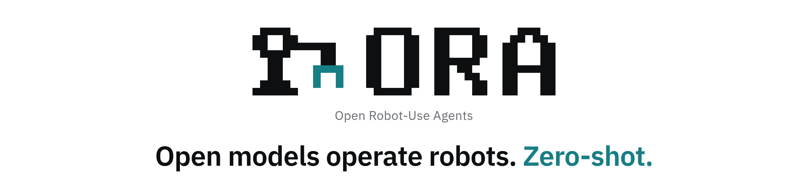
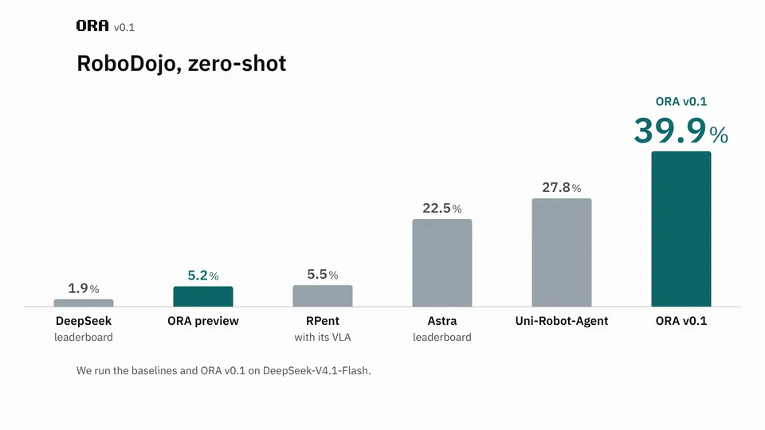
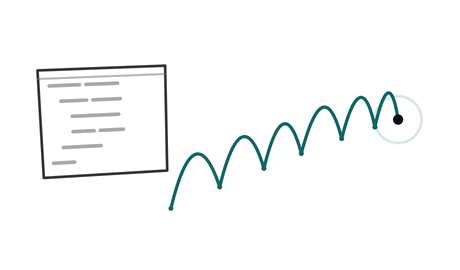
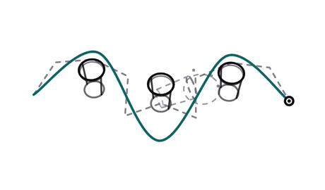
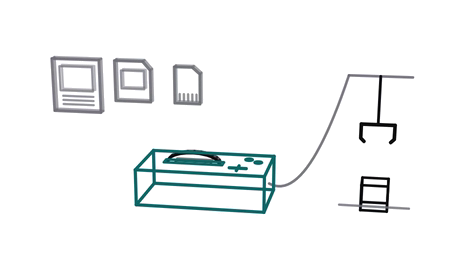
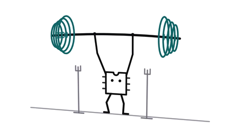
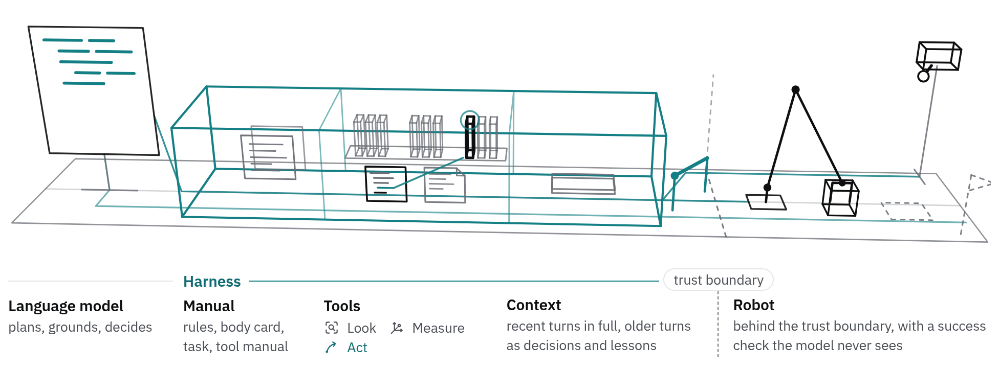

<p align="center">
  <a href="https://fastrua.ai/ora/"><picture><source media="(prefers-color-scheme: dark)" srcset="docs/assets/images/ora-banner-dark.webp"><source media="(prefers-color-scheme: light)" srcset="docs/assets/images/ora-banner-light.webp"></picture></a>
</p>

<p align="center">
  <strong>ORA</strong> is an open harness that lets a language model operate a robot through camera images and tools:<br>
  open-weight models, zero-shot, with no VLA, no robot training and no task memory.
</p>

<p align="center">
  <a href="https://github.com/fast-rua/ORA/releases"></a>
  <a href="LICENSE"></a>
  <a href="https://fastrua.ai/ora/docs/"></a>
  <a href="https://fastrua.ai/blog/2026-11-code-mode/"></a>
</p>

<p align="center">
  <a href="https://fastrua.ai/ora/"><strong>Website</strong></a> ·
  <a href="https://fastrua.ai/blog/2026-11-code-mode/">Blog</a> ·
  <a href="https://fastrua.ai/ora/docs/">Docs</a> ·
  <a href="https://fastrua.ai/ora/gallery/">Gallery</a> ·
  <a href="#quick-start">Quick start</a> ·
  <a href="#results">Results</a> ·
  <a href="#how-it-works">How it works</a> ·
  <a href="#citation">Citation</a>
</p>

<p align="center">
<a href="https://fastrua.ai/blog/2026-11-code-mode/"><picture><source media="(prefers-color-scheme: dark)" srcset="docs/assets/images/ora-teaser-dark.webp"><source media="(prefers-color-scheme: light)" srcset="docs/assets/images/ora-teaser-light.webp"></picture></a>
<br><sub>From the v0.1 film. <a href="https://fastrua.ai/blog/2026-11-code-mode/">Watch all 91 seconds, with sound</a>, or open the runs in the <a href="https://fastrua.ai/ora/gallery/">gallery</a>.</sub>
</p>

## New in v0.1

v0.1 follows October's preview. With the open-weight DeepSeek-V4.1-Flash it solves 39.9% of RoboDojo zero-shot. [Read the post](https://fastrua.ai/blog/2026-11-code-mode/).

<table>
<tr>
<td width="25%" align="center" valign="top"><a href="https://fastrua.ai/blog/2026-11-code-mode/#code-mode"><picture><source media="(prefers-color-scheme: dark)" srcset="docs/assets/images/ora-can-code-dark.webp"><source media="(prefers-color-scheme: light)" srcset="docs/assets/images/ora-can-code-light.webp"></picture></a><br><b>Write code</b><br>The model writes Python against the same robot tools; one turn carries 3.6 robot actions instead of 1.1.</td>
<td width="25%" align="center" valign="top"><a href="https://fastrua.ai/blog/2026-11-code-mode/#smooth-motion"><picture><source media="(prefers-color-scheme: dark)" srcset="docs/assets/images/ora-can-smooth-dark.webp"><source media="(prefers-color-scheme: light)" srcset="docs/assets/images/ora-can-smooth-light.webp"></picture></a><br><b>Move smoothly</b><br>Every move is planned around what the depth cameras see; moves stopped by a collision fall from 14.1% to 7.0% on RoboDojo.</td>
<td width="25%" align="center" valign="top"><a href="https://fastrua.ai/blog/2026-11-code-mode/#models"><picture><source media="(prefers-color-scheme: dark)" srcset="docs/assets/images/ora-can-models-dark.webp"><source media="(prefers-color-scheme: light)" srcset="docs/assets/images/ora-can-models-light.webp"></picture></a><br><b>Work across open models</b><br>In code mode on 39 RoboDojo tasks, six open models solve from 48.7% (DeepSeek) down to 5.1% (Nemotron).</td>
<td width="25%" align="center" valign="top"><a href="https://fastrua.ai/blog/2026-11-code-mode/#harness-and-model"><picture><source media="(prefers-color-scheme: dark)" srcset="docs/assets/images/ora-can-train-dark.webp"><source media="(prefers-color-scheme: light)" srcset="docs/assets/images/ora-can-train-light.webp"></picture></a><br><b>Cold-start post-training</b><br>On RoboLab-120, Qwen3.8-27B solves 5.4% alone, 52.5% inside ORA, and 61.9% with <a href="https://arxiv.org/abs/2611.18562">PEAR</a>'s training on top.</td>
</tr>
</table>

[Release notes](https://github.com/fast-rua/ORA/releases/tag/v0.1.0) · [Changelog](CHANGELOG.md) · `2026/11/18` ORA v0.1 · `2026/10/15` [ORA preview](https://fastrua.ai/blog/2026-10-ora/)

## Results

DeepSeek-V4.1-Flash, zero-shot, each benchmark's own success check, every success counted. The runs behind these numbers open in the [gallery](https://fastrua.ai/ora/gallery/).

| Benchmark | Robot | Cases | Code mode | Tool calls |
|---|---|---:|---:|---:|
| **LIBERO-Pro** | Franka Panda | 800 | **87.5%** | 85.4% |
| **RoboTwin 2.0**, clean to randomized | two-arm ALOHA | 235 | **79.6%** | 80.4% |
| **RoboLab**, 100 of its 120 tasks | DROID Franka | 500 | **79.2%** | |
| **RoboDojo** | two-arm ARX X5 | 198 | **39.9%** | |

RoboLab and RoboDojo limit an episode's simulator steps; within the limit ORA solves 67.0% of RoboLab and 10.6% of RoboDojo. Baselines on the same cases and every count: [how successes are counted](https://fastrua.ai/blog/2026-11-code-mode/#counting), [the numbers in full](https://fastrua.ai/blog/2026-11-code-mode/#numbers).

## Quick start

**1. Install ORA and a simulator.** On a Linux machine with one NVIDIA GPU of 32 GB or more; no sudo.

```bash
curl -fsSL https://raw.githubusercontent.com/fast-rua/ORA/main/scripts/install.sh | sh
ora setup --env robodojo
```

**2. Run a task.** Store your model key once (DeepSeek's API by default), then run:

```bash
ora providers key DEEPSEEK_LOW_API_KEY
ora run --env robodojo --task general_pickup --confirm-launch
```

The terminal shows the model's words, its tool calls and the robot's cameras, and the run is sealed when it ends. No GPU at hand? The [first episode](https://fastrua.ai/ora/docs/quickstart/) runs the same loop on a synthetic robot.

## Documentation

| To | Read |
|---|---|
| install by hand, or see what the installer does | [Installation](https://fastrua.ai/ora/docs/getting-started/installation/) |
| use OpenAI, Anthropic or a self-hosted model | [Model APIs](https://fastrua.ai/ora/docs/getting-started/model-apis/) |
| pick a benchmark: LIBERO-Pro, RoboTwin 2.0, RoboDojo, RoboCasa365, RoboLab | [Supported setups](https://fastrua.ai/ora/docs/support/) · [One-GPU guide](https://fastrua.ai/ora/docs/getting-started/single-gpu/) |
| watch, replay or export a run (`ora watch`, `ora web`, `ora replay`) | [Run and inspect](https://fastrua.ai/ora/docs/usage/runs/) |
| give the robot instructions yourself (`ora play`) | [Free play](https://fastrua.ai/ora/docs/usage/play/) |
| run a real robot (I2RT YAM station) | [Real robot cells](https://fastrua.ai/ora/docs/usage/real-cells/) |
| run a benchmark at scale | [Official suites](https://fastrua.ai/ora/docs/getting-started/official-suite/) |
| look up a command or fix a failure | [Command reference](https://fastrua.ai/ora/docs/usage/cli-reference/) · [Troubleshooting](https://fastrua.ai/ora/docs/getting-started/troubleshooting/) |

## How it works

<p align="center">
<picture><source media="(prefers-color-scheme: dark)" srcset="docs/assets/images/ora-loop-dark.webp"><source media="(prefers-color-scheme: light)" srcset="docs/assets/images/ora-loop-light.webp"></picture>
</p>

An agent works in a loop. The model asks for an action; the harness, with its manual, tools and context, carries it out on the robot and returns what happened; the model decides again. In code mode one turn carries a program instead of a single call. Every motion passes a supervisor, the benchmark's own check gives the verdict, and every request, action and receipt is sealed so a run can be replayed. [How ORA works](https://fastrua.ai/ora/docs/how-ora-works/) · [Architecture](https://fastrua.ai/ora/docs/architecture/)

## Versions

`main` is the latest release, and every release keeps its tag: `v0.1.0` is this one, and [`v0.1.0-preview`](https://github.com/fast-rua/ORA/tree/v0.1.0-preview) is October's preview, unchanged. To stay on a version, check out its tag and follow that version's README; from v0.1.0 on, `install.sh | sh -s -- --ref TAG` installs a given release. What changed and what an upgrade needs is in the [changelog](CHANGELOG.md).

## Contributing

[Start contributing](https://fastrua.ai/ora/docs/developer/onboarding/) covers the first hour and [CONTRIBUTING.md](CONTRIBUTING.md) the path to a pull request. To report a bug, [open an issue](https://github.com/fast-rua/ORA/issues); for a security problem see [SECURITY.md](SECURITY.md).

## Acknowledgements

We thank the RPent team for releasing their evaluation cases, leaderboard and code ([Harness VLA](https://arxiv.org/abs/2607.08448)); the authors of [CaP-X](https://arxiv.org/abs/2603.22435) and [ASPIRE](https://arxiv.org/abs/2607.00272), whose work inspired ORA's tools; and DeepSeek for releasing DeepSeek-V4.1-Flash as an open-weight model. We thank [Zhaoning Wang](https://www.zhaoningwang.com/) for deploying ORA on a real robot, and [Runyu Lu](https://runyulu.com/) and [Nan Xue](https://xuenan.net/) for helpful discussions.

ORA builds on open-source work: [LIBERO](https://github.com/Lifelong-Robot-Learning/LIBERO), [LIBERO-Pro](https://github.com/Zxy-MLlab/LIBERO-PRO), [RoboTwin 2.0](https://github.com/RoboTwin-Platform/RoboTwin), [RoboDojo](https://github.com/RoboDojo-Benchmark/RoboDojo), [RoboCasa365](https://github.com/robocasa/robocasa) and [RoboLab](https://github.com/NVlabs/RoboLab) as benchmarks; [SAM 3](https://arxiv.org/abs/2511.16719), [Contact-GraspNet](https://arxiv.org/abs/2103.14127) and [cuRobo](https://arxiv.org/abs/2310.17274) as tools; and [pi-tui](https://www.npmjs.com/package/@earendil-works/pi-tui) for the terminal UI. Code adapted from RoboTwin and CaP-X keeps its original license; see [NOTICE](NOTICE).

## Citation

```bibtex
@misc{ora2026v01,
  title        = {{ORA} v0.1: Robot-Use Agents Now Write Code, Move Smoothly, and Reach 40\% on {RoboDojo}},
  author       = {Yuanbo Yang and Junda Chen and Quanquan Peng and Yulun Wu and Shaoxiong Duan and Hao Zhang},
  year         = {2026},
  month        = nov,
  howpublished = {FastRUA Blog},
  url          = {https://fastrua.ai/blog/2026-11-code-mode/}
}
```

Licensed under [Apache-2.0](LICENSE). Bundled third-party code retains the notices in [NOTICE](NOTICE).
