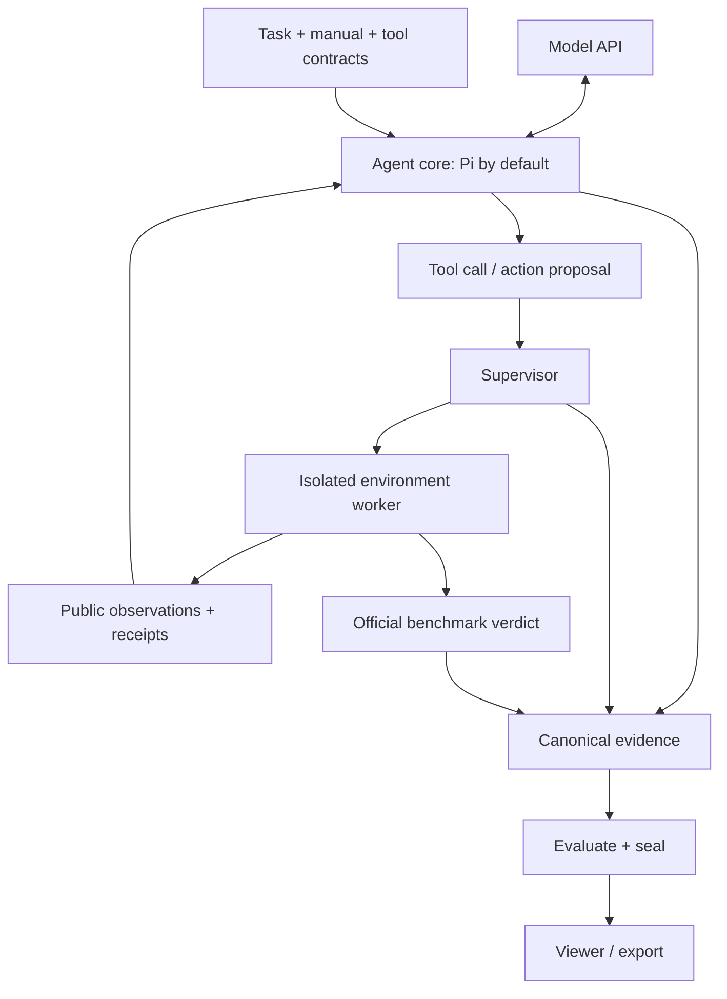

# Architecture

ORA has two loops: the agent (the policy) decides what to try; the trusted runtime decides whether and how an action may execute. [How ORA works](how-ora-works.md) walks through one turn and the interfaces that share it.



The agent can inspect public observations and propose actions. It cannot mutate simulator state directly, inspect privileged task state or set the official verdict. Read-only geometry/perception tools produce evidence; mutation tools submit versioned proposals to the Supervisor. Motion planning and simulator stepping remain behind the environment boundary.

The worker runs in the simulator's interpreter over `local_rpc`. Simulator imports stay out of the host-safe resolver, benchmark catalogs and contracts. Synthetic uses an in-process environment for infrastructure checks.

A RunSpec supplies task, provider, resources and budgets. Resolution selects a default baseline when applicable, binds policy assets and source identity, and produces a content-addressed RunPlan. Preflight checks fresh dependencies and admission before a resource lease is claimed. The supervisor executes the exact plan and attempts evaluation/sealing at landing.

The agent core's context assembly preserves the task, tool contract and current public state while managing tool history and recoverable artifacts. Context artifacts are episode evidence; they are not cross-episode Task Memory.

## Layers

The Python package `ora` has four layers, and each imports only the layers
below it:

```text
ora/app            the `ora` command: parse, ask, print, draw
   |
ora/orchestrator   RunSpec to RunPlan, preflight, leases, launch, the
   |               Supervisor's episode loop, evaluation, sealing, reports
   +---------------------------+
   |                           |
ora/agent                   ora/environment
the policy side: tools,     sessions, the isolated worker,
composition, context,       Synthetic, the simulator backends
providers, the agent trace
   |                           |
   +---------------------------+
   |
ora/contracts      the action envelope and the contracts both sides share
```

`ora/agent` and `ora/environment` never import each other: they meet in
`ora/contracts`, and the orchestrator binds a policy session to an environment
session. Beside the layers sit `ora/policy` (data only, pinned by
`policy.lock`) and `ora/robot_client` (standard library only). The TypeScript
agent core in `ora-pi/` reaches Python only over its RPC channel, and the
read-only `viewer/` imports `ora` while `ora` never imports it.
`tests/repository/test_structure.py` checks these rules on every change.

## Where a backend lives

Code that belongs to one simulator lives in exactly two places:

| Location | Runs | Holds |
|---|---|---|
| `ora/environment/backends/<sim>/` | Inside the simulator's own interpreter, in the isolated worker | Scene construction, observations, motion execution, the official verdict; `ora/environment/definitions.py` names its worker session as a `"module:attr"` string |
| `ora/orchestrator/backends/<kind>/` | On the host, in ORA's interpreter | The kind's RunSpec fields, preflight, seed or lane qualification, evaluation hooks, play scenes and `ora run` cell; `ora/orchestrator/backends/registry.py` maps each `runtime.kind` to its backend as a `"module:attr"` string |

The environment core loads a backend only in the worker
(`ora/environment/worker.py`), and the orchestrator core reaches one only
through the registry, so neither imports a simulator. The host-safe facts both
sides need (task identities, pins, controller limits) are in
`ora/environment/benchmarks/` and `ora/environment/controllers/`.
[Add an environment](developer/add-backend.md) walks through both halves, and
the [code map](code-map.md) links every package's README.

## One motion base for every backend

Motion planning, inverse kinematics, the collision world, path timing (TOPP-RA
and Ruckig), the wrist-unwind guard and the refusal vocabulary are one
simulator-independent base that every backend shares:
`ora/environment/controllers/motion_*` and `ora/environment/planners/`. A
backend supplies only three things: its robot configuration, which must pass a
forward-kinematics parity check against the simulator's own kinematics; an
execution adapter that writes the base's joint targets to the simulator or robot
and reads the measured state back; and, for a real robot, its calibration. A
backend-local IK solver or planner needs a written reason, an owner and an
expiry beside its code: `motion_exception.py` in the backend's directory,
which `tests/repository/test_motion_exceptions.py` requires of any backend that
plans its own motions and fails once it has expired. The YAM station has one
(its `motion.py`, until the shared planner and timing are qualified on the real
cell).

Status on 2026-11-01: LIBERO, RoboDojo, RoboTwin, RoboCasa365 and RoboLab plan on the
shared planner (cuRobo V2 behind `controllers/motion_planner.py`, in the public-depth
collision world; for the two-arm X5 and ALOHA the other arm stands in that world) and
time every route with the shared timing worker; `shared_motion.py` in
`environment/backends/{robodojo,robotwin,robocasa,robolab}/` is the whole of what each adds.
The SDK's IK still answers RoboDojo's straight lines; RoboCasa's are the shared IK's,
and its Panda plans as `franka_panda`, so the Omron base and torso are no robot links
and count only where the cameras see them. RoboLab's servo stays for contact and short
moves, under the shared step caps ([motion speed](reference/motion-speed.md)). The
vendored planner stays in RoboTwin's worker for the expert, the seed scans and a session
with no bound planner, and takes a move when the shared worker errors; the exception's
owner is the qualification pin (`session.py`, `vendored/`), and it ends when the seed
scans re-qualify on the shared planner.

Status on 2026-11-15: the real YAM station plans its own IK lines
(`environment/backends/yam/motion.py`) by default. A run may plan them on the shared
planner instead (`runtime.motion_planner`, `ora play --motion-planner`, off by default;
`backends/yam/shared_planner.py`) and time them with the shared timing worker
(`runtime.motion_timing`, `ora play --motion-timing`, off by default;
`backends/yam/shared_motion.py`); both stay off until they are qualified on the real
cell with the operator present ([motion speed](reference/motion-speed.md#yam)).

`controllers/fk_parity.py` is the check every robot passes before a planner speaks
for it: the planner's forward kinematics against the simulator's, at session start
and from a recorded fixture in CI (`tests/data/fk-parity/`).

The real bimanual I2RT YAM cell is the exception still open: by default it plans with its own
mink IK and planner (`environment/backends/yam/motion.py`). The shared planner has a robot for
it, `yam_linear_4310` (`planners/curobo_v2/yam.py`: one arm of i2rt's station URDF for either
arm, the other arm in the world as for the X5 and the ALOHA), with its recorded parity fixture,
and since 2026-11-15 the backend plans on it behind `runtime.motion_planner`
(`backends/yam/shared_planner.py`): a free-space move is one collision-free plan in the
public-depth world of the station's four calibrated cameras, a precision or contact move the
station's straight line by the shared IK, checked in that world; the cell's calibration is
carried as the [planners README](../ora/environment/planners/README.md) describes, and the
station's timing, per-tick checks and refusal words stay. The exception ends when the switch
is qualified on the real cell and made the default.

[Runtime lifecycle](reference/runtime-lifecycle.md) · [Interfaces](reference/public-interfaces.md) · [Configuration and evidence](reference/configuration-and-evidence.md)
