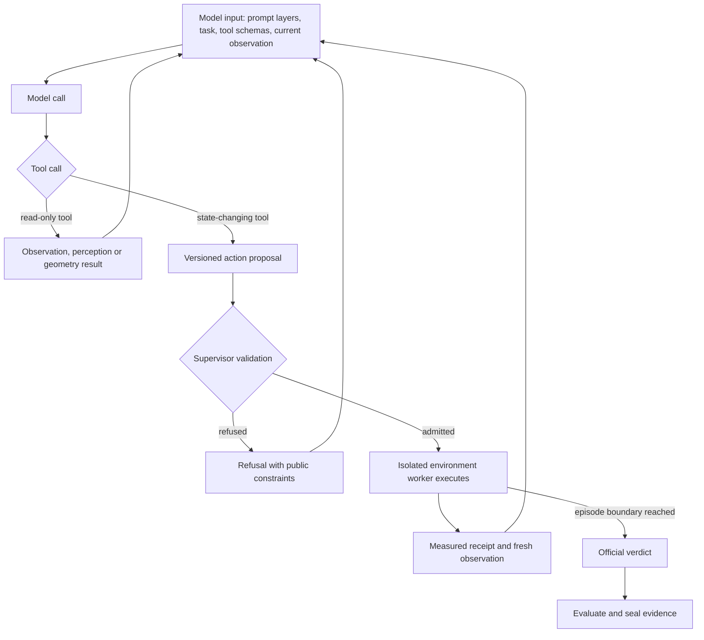

# How ORA works

ORA runs a language model as a robot policy. This page explains the parts a
run passes through and who holds authority at each step. The
[runtime lifecycle](reference/runtime-lifecycle.md) and
[public interfaces](reference/public-interfaces.md) pages hold the exact
contracts.

## Two loops

Three parts share a run, and each decides one thing.

| Part | Decides | Cannot |
|---|---|---|
| The agent (the policy) | What to look at and what to try next | Change simulator state directly, read privileged task state, or set the result |
| The Supervisor (the trusted runtime) | Whether a proposed action is admitted, and how it executes | Choose the agent's next step |
| The environment's official boundary | Whether the task succeeded | Be overruled by the agent |

The agent loop is a model calling tools. The runtime loop is the Supervisor
checking each action proposal, dispatching it to an isolated environment
worker and publishing the measured result. Success comes only from the
benchmark's own check: RoboTwin `check_success`, LIBERO termination or
RoboDojo's task verdict. A model's `finish_episode` call or a written claim of
success does not change that verdict. Synthetic, the simulator-free test
world, reports `official_success: null`.

In the source, the agent's tools, composition and context rules are
`ora/agent/` and its model loop is the TypeScript core in `ora-pi/`; the
Supervisor and the rest of a run's orchestration are `ora/orchestrator/`
(the episode loop in `ora/orchestrator/episode/`); the environment worker and
the simulator adapters are `ora/environment/`. The [code map](code-map.md)
links each package's README.

## One turn

Before a run starts, ORA resolves a RunSpec (task, provider, resources and
budgets) into a content-addressed RunPlan, checks it in preflight and claims a
resource lease. The Supervisor then opens one policy session and one
environment session and runs turns until the episode ends.

**Model input.** The request is built from the prompt bundle's ordered
layers: a system layer, project instructions (the action loop, the
environment's boundary and the embodiment manual with the robot's frames,
units and control semantics), the task in the first user message, the
ToolSurface's schemas in the provider's tools field, and the current public
state in the latest user message. That state carries the camera images,
proprioception, the previous action's receipt and the remaining budget.
[Context assembly](context-assembly.md) describes the layers and how tool
history is kept; [frames and units](robots/frames-and-units.md) describes the
robot facts the manual publishes.

**Model call.** The agent core sends the request to an OpenAI-compatible or
Anthropic Messages endpoint and receives text and tool calls.

**Tool call.** Every tool is defined by the run's ToolSurface, which fixes its
name, schema and declared effect. Tools fall into two groups:

- *Read-only tools* (`observation.dump_state`, perception, geometry,
  `compute`) run against the current observation and return evidence. They
  cannot change robot state.
- *State-changing tools* submit a versioned action proposal. In the shared
  profiles this is `robot.submit_action`; a surface may name its motion,
  gripper or skill tools differently, but every one of them goes to the
  Supervisor.

**Supervisor validation.** The Supervisor checks the proposal against the
action contract, the observation it was made from, the remaining budget and
the environment's limits. A refusal names the failed stage, a stable code and
the public constraint that was violated, and the refused action is not
executed. One action runs per observation step.

**Execution.** An admitted proposal goes to the environment worker, which
runs in the simulator's own interpreter over `local_rpc` (Synthetic runs in
process). Motion planning and simulator stepping happen behind this boundary.
The worker returns a measured receipt and a fresh observation, and the next
turn starts from them. Contact can change the measured state; the agent sees
that change as evidence.

**End of the episode.** An episode ends when the environment reaches its
boundary, a budget runs out, the agent calls a lifecycle tool, or an operator
stops it. On landing the Supervisor derives metrics, evaluates the trace,
binds the official verdict and attempts to seal the run: a hash-bound,
immutable inventory of plan, requests, responses, tool calls, proposals,
receipts and result. An invalid trace gets a recorded seal refusal instead of
a seal. See [configuration and evidence](reference/configuration-and-evidence.md#episode-evidence)
and the [evaluation protocol](evaluation/protocol.md).

## The agent core

The agent core runs the model loop: provider calls, request assembly, context
management and the agent-side evidence. By default it is a TypeScript core in
`ora-pi/`, built on pinned
[Pi](https://www.npmjs.com/package/@earendil-works/pi-coding-agent) packages
and run by Node.js under Node's permission model.

Robot semantics stay in Python. The Supervisor starts the core as a child
process and talks to it over a JSON-lines socket. The core calls back into
Python (`ora.agent.pi`) for every tool, observation and static context slot,
receives images as sha256 references, and may write only the run's agent
evidence. Tools, the ToolSurface, the action contracts and all authority over
the robot live on the Python side. If the core process exits, the policy
session restarts it a bounded number of times and resumes from the Pi session
file without running any tool twice.

In a benchmark episode the core applies ORA's context composition and
retention policy, and Pi commands that would change the model, reasoning
effort, compaction or session are refused. In [free play](usage/play.md) the
agent is Pi itself as a coding agent, with Pi's own context, compaction and
coding tools, plus ORA's robot tools.

ORA's earlier Python Native core ran the same lifecycle in process. It was
removed from ORA and remains only in the robot-harness repository; Pi
reproduced its requests byte for byte. A plan resolved for it does not start,
while its sealed runs still evaluate, open in the viewer and replay. See
[agent core](reference/configuration-and-evidence.md#agent-core).

## Every interface uses the same run path

The terminal UI, the browser page, scripts and remote sessions are clients of
a run. None of them has its own execution path: a launch from any of them
resolves the plan, runs preflight, takes the lease and starts a Supervisor,
and every robot action still crosses that Supervisor. Typed messages enter
the conversation before the next model call; they cannot alter a request in
flight, execute a tool or override admission. A run that received an operator
message keeps its official verdict but is marked human-assisted and excluded
from autonomous success rates.

| Interface | What it is for | How it connects | Who drives it | Read next |
|---|---|---|---|---|
| `ora run` | One task: the Synthetic first episode, or one LIBERO, RoboTwin or RoboDojo task on a single-GPU host | Starts a Supervisor; a simulator task first opens the task picker | The model | [First episode](quickstart.md), [one GPU](getting-started/single-gpu.md) |
| `ora play` | Free play: a qualified scene with no task, never scored | The scene runs in the background; your terminal attaches to it | You give instructions; the model carries them out | [Free play](usage/play.md) |
| Terminal UI, `ora attach` | Watch and steer a running run, detach and come back | Attaches to the run's agent; detaching leaves the run going | The model; you steer or stop | [Interactive sessions](usage/interactive.md) |
| `ora watch` | Follow a live run or replay a finished one | Reads the recorded evidence only | No one; read-only | [Run and inspect](usage/runs.md) |
| `ora web` | The conversation and cameras of a live run in the browser | A local web server connected to the run, opened with a one-time token | The model; you send messages or stop | [Web view](usage/remote.md#web-view) |
| `ora-remote` | Use a run on a GPU server from your own computer | Runs any of the commands above on the server over one SSH connection | Whoever drives the wrapped command | [Remote GPU server](usage/remote.md) |
| Codemode, `ora-robot` | Let the agent script the robot in free play | Each script call goes to the Supervisor like any other action; codemode runs in a sandbox | A script the agent writes | [Scripting the robot](usage/play.md#scripting-the-robot) |
| JSON events and RPC | Drive or observe a run from another program | One controlling client and any number of observers; `ora watch --raw` prints the event stream | Your program | [Public interfaces](reference/public-interfaces.md) |
| Python API | Load, resolve and validate plans; compose benchmark cells; call `run_episode` | In your own Python process; launches still go through the CLI | Your code | [Python API](api/README.md) |

## What the policy can and cannot see

The policy sees public observations, the task instruction, the robot manual
and the advertised tools. Perception tools compute their results from the
public camera data.

The policy never receives object ground truth, simulator segmentation or
contact state, the task source, expert code or the private success predicate.
It cannot set the official verdict. Tool refusals carry public constraints
only, not private paths, object state or stack traces. In free play the scene's
task language and success predicate are withheld as well.

One caution for free play: the agent's shell runs as you, with credential
variables removed, and ORA adds no sandbox around it, so the shell can read
any file you can read. Codemode is the sandboxed way to script.

See [safety](usage/safety.md) for the operator-facing rules and
[policy inputs and outputs](reference/policy-io.md) for the exact contract.

## Read next

- [Architecture](architecture.md) for the components and trust boundary.
- [Runtime lifecycle](reference/runtime-lifecycle.md) for plan, admission,
  execution, landing and sealing.
- [Glossary](glossary.md) for RunSpec, RunPlan, ToolSurface, receipt and seal.
- [Code map](code-map.md) for where each part lives in the source.
